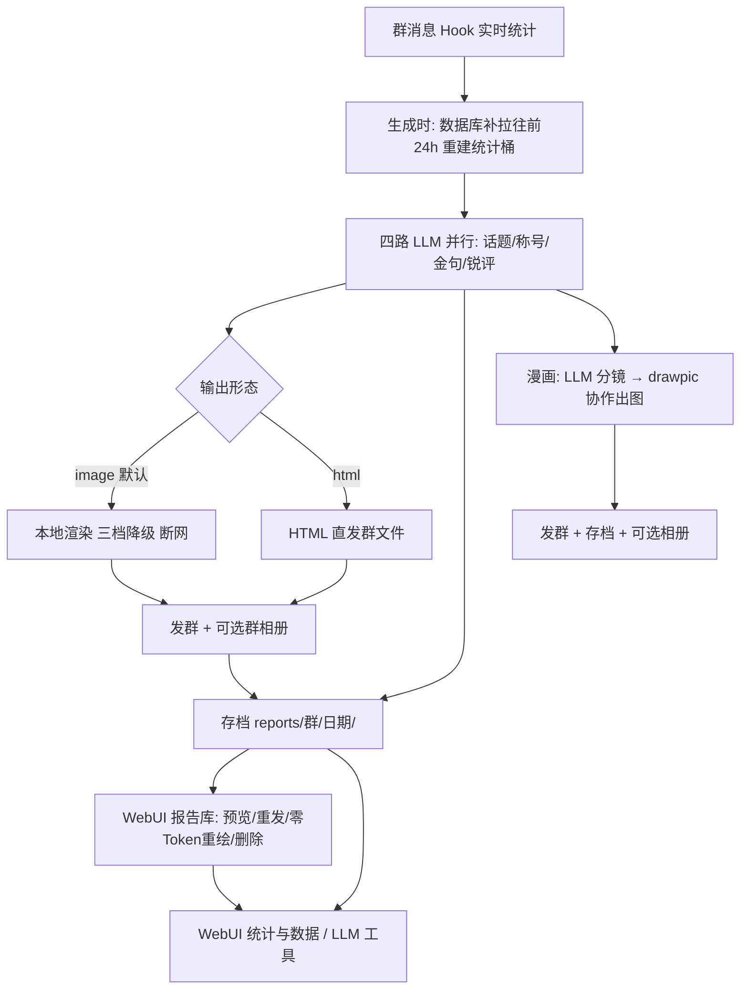

# 群聊每日分析

> 每天自动给群聊生成一份图文日报：**高光话题**、**神人称号**、**金句宝藏瓶**、**聊天质量锐评**；
> 还能把日报画成**四格漫画 / 单幅海报**，并提供 **WebUI 控制台**（报告库 / 漫画廊 / 统计与数据）与 **LLM 原生工具**。
> 12 套日报主题、12 套漫画风格、本地零外发渲染（可选云端加速）、自动上传 QQ 群相册、跟随 MaiBot 宿主三套 UI 风格。

本插件是 AstrBot 插件 [astrbot_plugin_qq_group_daily_analysis](https://github.com/SXP-Simon/astrbot_plugin_qq_group_daily_analysis) 的 **MaiBot 移植重构版**（MIT）。当前版本 **1.6.0**。

---

## 一、功能总览

| 块 | 能力 |
|---|---|
| 日报分析 | 话题 / 称号 / 金句 / 锐评四板块；人格标签 sbti/mbti/acgti；滚动 24h 统计（跨天、不依赖整日在线） |
| 日报输出 | 12 套主题本地渲染（断网、三档降级）；可选云端加速；可选 HTML 直发群文件；自动上传群相册 |
| 漫画生成 | 12 套风格 + 顺序/随机/洗牌轮换；多角色方案 + 每日随机角色；参考图管理；经麦麦绘图(drawpic)协作；幂等恢复不重画 |
| WebUI 控制台 | 报告库（筛选/预览/重发/零Token重绘/删除/生成/取消）；漫画廊；统计与数据（趋势/Token 审计/存储管理） |
| 统计与 Token | 48h/7/14/30 天趋势（折线/堆叠柱/表格）；模型/任务/服务商占比饼图；事件时间线；存储分区与批量删除、缓存清理 |
| LLM 原生工具 | 自然语言「查报告」（只读、脱敏、0 额外额度）；管理员「触发分析」（异步受理） |
| 宿主主题适配 | 跟随 MaiBot 仪表盘 modern / 千禧 / 未来复古 × 明暗实时切换，无需刷新 |

---

## 二、三分钟上手

1. **安装**：把本插件目录放进 MaiBot 的 `plugins/` 下，重启或在插件管理里加载（需宿主 ≥1.3.19、SDK ≥2.12.0）。
2. **填群白名单**：插件设置 → 日报设置 → 「群白名单」，每行一个群号（留空 = 所有群）。
3. **开定时**：日报设置 → 打开「每日日报开关」，设置发送小时/分钟；可用「定时日报群列表」限定部分群。
4. **手动试一次**：群里发 `/日报`（管理员名单可配）。生成约 2~6 分钟，完成后自动发图。

> 机器人在定时点之后才启动/重载时会**自动补发**当天日报，不会漏。

---

## 三、WebUI 控制台（1.6.0）

顶部「群聊分析」工作区提供三个页面，顶部按钮可互相跳转；页面跟随宿主 UI 风格与明暗。

### 报告库

- 报告自动存入 `data/plugins/maibot-plugin-qq-group-daily-analysis/reports/<群>/<日期>/`，插件更新不覆盖存档。
- 按群/日期筛选 + 关键词搜索 + 类型筛选 + 排序；缩略图点开看原图（分块拼装、自然尺寸）。
- **重发**只发成品不重新分析；**换主题重绘**用已存分析免 Token 重新出图替换存档；**删除**仅删存档不删聊天消息。
- **生成**调用模型并发往所选群（今天=滚动24h，历史日需仍有统计桶）；**后台任务**统一覆盖 WebUI/命令/定时/联动四来源，可取消。
- 保留期 `archive_retention_days` 默认 90 天（0=不清理）。沙箱不允许页面直接下载，下载按钮禁用。

### 漫画廊

- 把当日日报画成**四格漫画 / 单幅海报**等 12 套风格；LLM 分镜 → 经**麦麦绘图(drawpic)协作**出图 → 发群 + 存档 + 可选群相册。
- **风格轮换**（顺序/随机/洗牌）+ **多角色方案**（独立人设/场景/参考图）+ **每日随机角色**，均可在页面开关。
- **参考图**上传（宿主压缩 4096）/重命名/灯箱放大/删除；绘图时附带以固定角色形象与画风。
- **幂等恢复**：请求键先落盘再提交；回执未知保留原键，「恢复进度」只读查证绝不换键重画；已存档未发送只补发。
- 日报发送成功后可对联动群**自动追加漫画**；`/漫画` 命令手动触发。

漫画成品示例（四格风格示意）：

### 统计与数据

- 今日概览（今日报告/最近生成/今日消息）+ 48h/7/14/30 天消息/报告趋势。
- **Token 审计**：总/输入/输出/调用次数/成功率/活跃群；趋势**折线 / 堆叠柱 / 表格**三态；**模型 / 任务模块 / 服务商**占比饼图（宿主本机统计）。
- **事件时间线** + **存储管理**（分区明细、报告批量删除、运行时缓存清理）。

### 宿主主题适配

跟随 MaiBot 仪表盘 **modern / 千禧 / 未来复古** × 明暗实时切换（背景/面板/按钮/字体/纹理均由宿主注入），独立打开时回退自有配色。

| 风格 | 明 | 暗 |
|:--:|:--:|:--:|
| modern |  |  |
| 千禧 |  |  |
| 未来复古 |  |  |

---

## 四、LLM 原生工具

| 工具 | 说明 |
|---|---|
| `group_daily_report_lookup` | 自然语言查历史日报（今天/昨天/N天前/日期 + 群名/群号），只读返回紧凑 Markdown，ID 脱敏、40000 字截断，**0 额外模型额度** |
| `group_daily_analysis_trigger` | 管理员异步触发本群日报：受理即返回凭证，后台完成后自动发群；普通成员被引导改用查报告 |

---

## 五、命令

| 命令 | 说明 |
|---|---|
| `/日报` | 生成本群当日日报（约 2~6 分钟，完成后自动发送） |
| `/日报 主题名` | 指定主题生成，例如 `/日报 scrapbook` |
| `/漫画` | 把本群今日日报画成漫画（需当日已有日报存档且启用群聊漫画） |

---

## 六、常用配置

### 日报设置
| 配置 | 说明 |
|---|---|
| 群白名单 / 命令管理员 | 每行一个群号 / QQ 号；留空 = 所有群 / 所有人 |
| 每日日报开关 / 发送小时 / 分钟 / 定时日报群列表 | 定时生成时间与范围 |
| 默认日报主题 / 按群指定主题 | 12 套皮肤；`群号=主题` 优先于默认 |
| 手动日报计入当天已发 | 开启后手动 `/日报` 当天定时不再重复发 |
| 日报输出形态 | `image` 渲染成图（默认）/ `html` 直发群文件 |
| 启用云端渲染 / 分辨率档位 | **默认关闭**；开启=把日报内容交给第三方 t2i，见「八、工作原理」 |

### 分析设置
| 配置 | 说明 |
|---|---|
| 四类分析开关 / 最大话题·称号·金句数 | 板块开关与上限 |
| 生成日报最低消息数 | 低于此数不发（默认 150） |
| 统计机器人自身发言 | **默认关闭**；开启后重建 24h 数据时纳入机器人自己的发言（只放开机器人过滤，命令/转发仍过滤；纳入≠必被选中；旧报告不自动变） |
| 人格标签展示模式 | `sbti` 整活 / `mbti` 标准 / `acgti` 二次元 |
| 分析用模型任务名 / LLM 全局并发上限 | 默认 `auto`；并发闸门防限流 |

### 群相册上传
NapCat 与 SnowLuma 均支持（同一 OneBot v11 相册接口）。配置：生成后上传开关、默认相册名、按群指定相册、协议端 HTTP API 地址与访问令牌（NapCat `network.httpServers[].token`；SnowLuma `networks.httpServers[].accessToken`，默认端口 3002）。失败不影响发图。

### 分析提示词 / 官方 QQ 机器人
四板块提示词可改（支持 `${max_topics}` `${messages_text}` 等变量）+ 分析人设注入。官方 QQ 机器人（OpenID）自宿主 1.4.0 起无需配置支持：头像走 `chat.get_avatar`，昵称取入站消息（取不到显示「群友+OpenID后6位」）。

---

## 七、主题一览（12 套）

所有主题含同样四块内容 + 24h 活跃度图 + Token 页脚，差别在配色/字体/排版/板块文案。

| key | 名称 | 风格 |
|---|---|---|
| `atri` | ATRI | 浅蓝紫 · 霞鹜文楷 · 亚托莉立绘 |
| `bluearchive` | BlueArchive | 蔚蓝+青紫 · 阿洛娜 |
| `hatsunemiku` | 初音未来 | 葱绿+粉 · 科技面板 |
| `hack` | 黑客帝国 | 黑底橙字 · 等宽终端 |
| `retro_futurism` | 复古未来 | 米白+荧光绿 · CRT |
| `scrapbook` | 剪贴簿 | 点阵纸+手写体 · 卡通 |
| `spring_festival` | 新春 | 宣纸+红金 · 书法 |
| `simple` | 简约 | 灰白极简 |
| `format` | 格式报告 | 白底蓝字 · 正式文档 |
| `art_nouveau` | 新艺术运动 | 羊皮纸+森林绿×复古金 · 穆夏 |
| `maria` | 圣母在上 | 羊皮纸+古金墨绿酒红 · 学园茶会 |
| `deepseek_maid` | 鲸鱼女仆娘 | 白底蓝紫渐变 · 女仆娘立绘 |

**切换**：全局「默认日报主题」；分群「按群指定主题」(`群号=主题`)；临时 `/日报 主题名`。深色主题下人格水印自动切换混合模式。

### 主题预览（真实渲染结果）

缩略图截顶部区域，点击看 1000px 完整长图。

|**ATRI**|**BlueArchive**|**初音未来**|
|:--:|:--:|:--:|
||||

|**黑客帝国**|**复古未来**|**剪贴簿**|
|:--:|:--:|:--:|
||||

|**新春**|**简约**|**格式报告**|
|:--:|:--:|:--:|
||||

|**新艺术运动**|**圣母在上**|**鲸鱼女仆娘**|
|:--:|:--:|:--:|
||||

> 图片用 jsDelivr 镜像绝对外链（WebUI 详情页与 GitHub 都能显示；相对路径在 WebUI 会 404）。
> `art_nouveau`/`maria`/`deepseek_maid` 模板与素材移植自上游，许可见 [`THIRD-PARTY-NOTICES.md`](https://cdn.jsdmirror.com/gh/NetaJuutilainen/Maibot_plugin_qq_group_daily_analysis@main/THIRD-PARTY-NOTICES.md)（`deepseek_maid` 角色形象 CC BY-NC-SA 4.0）。

---

## 八、工作原理

**本地渲染默认零外发**：素材与字体全部内联进 HTML，渲染阶段完全断网，三档依次降级（1.5x→1.0x→精简），页面 2 秒自静止降低弱机负载；长记录自动分段分析再合并。

**云端渲染可选、默认关闭**：开启后整份日报 HTML 会 POST 到你填的第三方 t2i 服务，包含群聊样本/昵称/QQ 号/头像/日报全文。**开启=把群聊数据交给第三方**；追求零外发请保持关闭，或指向自建实例。请求使用标准 TLS 校验。

---

## 九、常见问题

<b>1. 提示「过去 24 小时只有 X 条消息（不足 N 条）」？</b>

统计口径是滚动 24h 真实消息数，低于「生成日报最低消息数」就跳过；到分析设置调低阈值。

<b>2. 定时到点却没发？</b>

检查开关与时间；定时点之后才启动/重载会自动补发；同群当天已发（含手动）则跳过（可关「手动日报计入当天已发」）。

<b>3. 图片 emoji 显示方块？</b>

已内嵌彩色 emoji 字体（Noto Color Emoji 分段），本地渲染优先系统 Segoe UI Emoji；仍异常请发渲染日志。

<b>4. 群相册上传失败？</b>

核对协议端 HTTP API 地址与令牌（NapCat `network.httpServers[].token`；SnowLuma `networks.httpServers[].accessToken`，端口默认 3002）；403=令牌没填/错，connection refused=HTTP 服务没开或填了 WebSocket 端口；相册名需完全一致（严格模式不存在则跳过）。⚠ 地址指向哪里数据就发往哪里，只填信任的地址。

<b>5. 生成慢 / 某板块空 / 弱机卡顿？</b>

2~6 分钟属正常；`E_TIMEOUT` 换更快模型任务或调大超时；板块空但调用成功多为模型返回对象包裹数组（已自动兼容）。弱机：渲染缩放调 1.0、宿主并发渲染调 1、或改 `html` 直发跳过渲染；2GB 内存注意渲染浏览器约 300MB 易触发 swap。

<b>6. 群聊数据会不会被发到第三方？</b>

**默认不会**（本地渲染、素材内联）。仅手动开启「云端渲染」后才把日报 HTML 发给所填 t2i 服务；在意隐私请保持关闭或指向自建实例。详见「八、工作原理」。

---

## 十、致谢与许可

本项目是以下开源项目的 **MaiBot 移植重构版**，按 MIT 保留原版权声明：

- **上游插件**：[SXP-Simon/astrbot_plugin_qq_group_daily_analysis](https://github.com/SXP-Simon/astrbot_plugin_qq_group_daily_analysis)  
  MIT License, Copyright (c) 2025 Helian Nuits  
  分析维度、12 套主题模板、人格标签映射、群相册思路来自原版；  
  `art_nouveau` / `maria` / `deepseek_maid` 三套自上游 v5.8.4 移植。
- **云端渲染服务**：[AstrBotDevs/astrbot-t2i-service](https://github.com/AstrBotDevs/astrbot-t2i-service)  
  云端文转图渲染服务。
- **字体素材**：霞鹜文楷（LXGW WenKai）、Noto Color Emoji  
  SIL OFL 1.1 许可。
- **本移植版**：MIT License, Copyright (c) 2026 NetaJuutilainenP

> ⚠️ 完整逐项第三方许可见 [`THIRD-PARTY-NOTICES.md`](https://cdn.jsdmirror.com/gh/NetaJuutilainen/Maibot_plugin_qq_group_daily_analysis@main/THIRD-PARTY-NOTICES.md)。  
> 上游代码与 12 套模板：**MIT**；  
> `deepseek_maid` 角色美术：**CC BY-NC-SA 4.0**（署名链：上善无形 / ZipZipPipe / StuGRua）；  
> `atri` / `bluearchive` / `hatsunemiku` / `maria` 角色 IP 归原作者，本项目与上游一样属非商业同人使用。