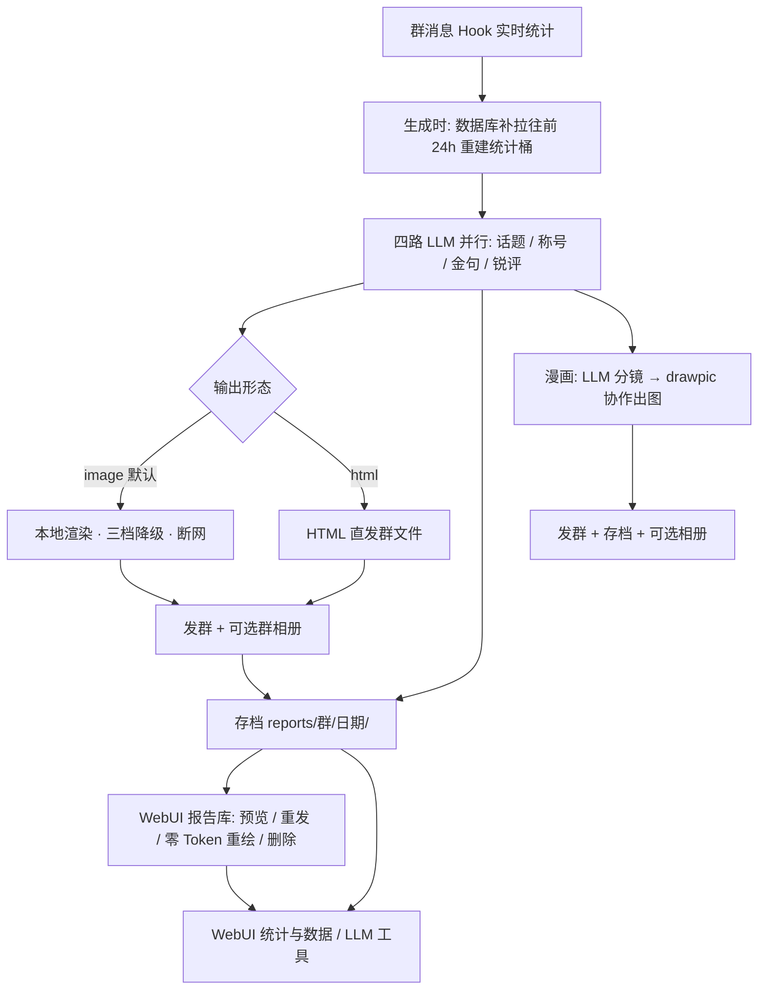

  <!-- Hero Banner (亮/暗色主题自适应) -->
  <picture>
    <source media="(prefers-color-scheme: dark)" srcset="https://cdn.jsdmirror.com/gh/NetaJuutilainen/Maibot_plugin_qq_group_daily_analysis@main/assets/readme/hero-night.svg">
    
  </picture>

   

  <!-- Badges -->
  

    
    = 1.3.19">
    
    
    
  

  

    每天自动生成群聊图文日报：<b>高光话题</b> · <b>神人称号</b> · <b>金句宝藏瓶</b> · <b>聊天质量锐评</b> 
    支持 <b>四格漫画 / 单幅海报</b>、<b>WebUI 控制台</b>、<b>LLM 原生工具</b> 与 <b>自动上传 QQ 群相册</b> 
    移植重构自 AstrBot 插件 <a href="https://github.com/SXP-Simon/astrbot_plugin_qq_group_daily_analysis">astrbot_plugin_qq_group_daily_analysis</a>（MIT）· 当前版本 <b>1.6.7</b>
  

  <!-- Quick Navigation -->
  

    <a href="#功能总览">功能总览</a> &middot;
    <a href="#主题预览">主题预览</a> &middot;
    <a href="#三分钟上手">三分钟上手</a> &middot;
    <a href="#webui-控制台">WebUI 控制台</a> &middot;
    <a href="#指令与工具">指令与工具</a> &middot;
    <a href="#常用配置">常用配置</a> &middot;
    <a href="#工作原理">工作原理</a> &middot;
    <a href="#常见问题">常见问题</a> &middot;
    <a href="#交流与反馈">交流与反馈</a>
  

---

## ✨ 一、功能总览

| 模块 | 核心能力 |
|---|---|
| 📊 **日报分析** | 话题 / 称号 / 金句 / 锐评四板块；人格标签 `sbti` / `mbti` / `acgti`；滚动 24h 统计（跨天、不依赖整日在线） |
| 🎨 **日报输出** | 12 套主题本地渲染（断网、三档降级）；可选云端加速；可选 HTML 直发群文件；自动上传群相册 |
| 🎞️ **漫画生成** | 17 套风格 + 顺序 / 随机 / 洗牌轮换；多角色方案 + 每日随机角色；参考图管理；经麦麦绘图 (`drawpic`) 协作；幂等恢复不重画 |
| 🖥️ **WebUI 控制台** | 报告库（筛选 / 预览 / 重发 / 零 Token 重绘 / 删除 / 生成 / 取消）；漫画廊；统计与数据（趋势 / Token 审计 / 存储管理） |
| 📈 **统计与 Token** | 48h / 7 / 14 / 30 天趋势（折线 / 堆叠柱 / 表格）；模型 / 任务 / 花费占比饼图；区间总花费；事件时间线；存储分区与批量删除、缓存清理 |
| 🤖 **LLM 原生工具** | 自然语言「查报告」（只读、脱敏、0 额外额度）；管理员「触发分析」（异步受理） |
| 🌓 **宿主主题适配** | 跟随 MaiBot 仪表盘 `modern` / `千禧` / `未来复古` × 明暗实时切换，无需刷新 |

---

## 🎨 二、主题一览（12 套）

所有主题均包含完整四板块内容 + 24h 活跃度图 + Token 页脚，差异体现在配色、字体、排版与板块文案。  
以下为真实渲染结果，**缩略图截取顶部区域，点击图片可查看 1000px 完整长图**：

|**ATRI**|**BlueArchive**|**初音未来**|
|:--:|:--:|:--:|
||||

|**黑客帝国**|**复古未来**|**剪贴簿**|
|:--:|:--:|:--:|
||||

|**新春**|**简约**|**格式报告**|
|:--:|:--:|:--:|
||||

|**新艺术运动**|**圣母在上**|**鲸鱼女仆娘**|
|:--:|:--:|:--:|
||||

<b>📋 展开查看 12 套主题 key 与切换说明</b>

| key | 名称 | 风格 |
|---|---|---|
| `atri` | ATRI | 浅蓝紫 · 霞鹜文楷 · 亚托莉立绘 |
| `bluearchive` | BlueArchive | 蔚蓝 + 青紫 · 阿洛娜 |
| `hatsunemiku` | 初音未来 | 葱绿 + 粉 · 科技面板 |
| `hack` | 黑客帝国 | 黑底橙字 · 等宽终端 |
| `retro_futurism` | 复古未来 | 米白 + 荧光绿 · CRT |
| `scrapbook` | 剪贴簿 | 点阵纸 + 手写体 · 卡通 |
| `spring_festival` | 新春 | 宣纸 + 红金 · 书法 |
| `simple` | 简约 | 灰白极简 |
| `format` | 格式报告 | 白底蓝字 · 正式文档 |
| `art_nouveau` | 新艺术运动 | 羊皮纸 + 森林绿 × 复古金 · 穆夏 |
| `maria` | 圣母在上 | 羊皮纸 + 古金墨绿酒红 · 学园茶会 |
| `deepseek_maid` | 鲸鱼女仆娘 | 白底蓝紫渐变 · 女仆娘立绘 |

**切换方式**：全局设置「默认日报主题」；分群设置「按群指定主题」（`群号=主题`）；或临时使用指令 `/日报 主题名`。深色主题下人格水印会自动切换混合模式。

> [!NOTE]
> - 图片使用 jsDelivr 镜像绝对外链（确保 WebUI 详情页与 GitHub 均可正常加载；相对路径在 WebUI 会 404）。CDN 与 GitHub Camo 对同一 URL 缓存约一年，**换图需同步更换文件名**。
> - `art_nouveau` / `maria` / `deepseek_maid` 模板与素材移植自上游，完整许可见 [`THIRD-PARTY-NOTICES.md`](https://cdn.jsdmirror.com/gh/NetaJuutilainen/Maibot_plugin_qq_group_daily_analysis@main/THIRD-PARTY-NOTICES.md)（`deepseek_maid` 角色形象遵循 CC BY-NC-SA 4.0）。

---

## 🚀 三、三分钟上手

1. **安装插件**：从 MaiBot 插件中心安装，或将本插件目录放入 MaiBot 的 `plugins/` 后重启 / 在插件管理中加载（需宿主 `>=1.3.19`、SDK `>=2.12.0`）。
2. **填写群白名单**：插件设置 → 日报设置 → 「群白名单」，每行一个群号（留空 = 所有群）。
3. **开启定时任务**：日报设置 → 打开「每日日报开关」，设置发送小时 / 分钟；可通过「定时日报群列表」限定部分群。
4. **手动试一次**：群里发送 `/日报`（管理员名单可配）。生成约 2~6 分钟，完成后自动发图。

> [!TIP]
> 机器人在定时点之后才启动或重载时，插件会**自动补发**当天日报，不用担心漏发。

---

## 🖥️ 四、WebUI 控制台

顶部「群聊分析」工作区提供三个页面，顶部按钮可互相跳转；页面样式跟随宿主 UI 风格与明暗主题实时切换。

### 1. 报告库

- 报告自动存入 `data/plugins/maibot-plugin-qq-group-daily-analysis/reports/<群>/<日期>/`，插件更新不覆盖历史存档。
- 支持按群 / 日期筛选 + 关键词搜索 + 类型筛选 + 排序；缩略图点开查看原图（分块拼装、自然尺寸）。
- **重发**只发成品不重新分析；**换主题重绘**利用已存分析免 Token 重新出图替换存档；**删除**仅删存档不删聊天消息。
- **生成**调用模型并发往所选群（今天 = 滚动 24h，历史日需仍有统计桶）；**后台任务**统一覆盖 WebUI / 命令 / 定时 / 联动四来源，支持随时取消。
- 保留期 `archive_retention_days` 默认 90 天（`0` = 不清理）。沙箱不允许页面直接下载，下载按钮默认禁用。

### 2. 漫画廊

- 将当日日报画成**四格漫画 / 单幅海报**等 17 套风格：LLM 分镜 → 经 **麦麦绘图 (`drawpic`) 协作**出图 → 发群 + 存档 + 可选群相册。
- **风格轮换**（顺序 / 随机 / 洗牌）+ **多角色方案**（独立人设 / 场景 / 参考图）+ **每日随机角色**，均可在页面内直接开关。
- **参考图管理**：支持上传（宿主压缩 4096）/ 重命名 / 灯箱放大 / 删除；绘图时自动附带以固定角色形象与画风。
- **幂等恢复**：请求键先落盘再提交；回执未知保留原键，「恢复进度」只读查证绝不换键重画；已存档未发送只补发。
- 日报发送成功后可对联动群**自动追加漫画**；也可使用 `/漫画` 命令手动触发。

漫画成品示例（服务器真实生成的漫画成品，点击图片可查看原图，其他风格示例后续增补）：

| 四格漫画 | 怪盗团预告信剪报 | 炼金术士魔导植物志 |
|:--:|:--:|:--:|
|  |  |  |

| Q版萌系多格 | 日系四格（多角色） | 更多风格持续增补 |
|:--:|:--:|:--:|
|  |  | 更多风格示例后续增补 |

### 3. 统计与数据

- 今日概览（今日报告 / 最近生成 / 今日消息）+ 48h / 7 / 14 / 30 天消息与报告趋势。
- **Token 审计**：总 / 输入 / 输出 / 调用次数 / 区间总花费 / 成功率 / 活跃群；趋势支持**折线 / 堆叠柱 / 表格**三态（柱状 Token 模式带输入 / 输出图例与悬停明细，零值日显示小柱）；**模型 / 任务模块 / 花费**占比饼图。Token 数据全部来自本插件 LLM 调用账本（`llm_usage.json`，近 30 天），不含宿主其他模块消耗；花费取自宿主对本插件调用的逐次计费记录，按宿主模型配置单价（含分时 / 缓存价）估算，非实际账单金额。
- **事件时间线** + **存储管理**（分区明细、报告批量删除、运行时缓存清理）。

### 4. 宿主主题适配

跟随 MaiBot 仪表盘 **modern / 千禧 / 未来复古** × 明暗实时切换（背景 / 面板 / 按钮 / 字体 / 纹理均由宿主注入），独立打开时回退自有配色。

| 风格 | 明 | 暗 |
|:--:|:--:|:--:|
| modern |  |  |
| 千禧 |  |  |
| 未来复古 |  |  |

---

## 💬 五、指令与 LLM 原生工具

### 群聊命令

| 命令 | 说明 |
|---|---|
| `/日报` | 生成本群当日日报（约 2~6 分钟，完成后自动发送） |
| `/日报 主题名` | 指定主题生成，例如 `/日报 scrapbook` |
| `/漫画` | 把本群今日日报画成漫画（需当日已有日报存档且启用群聊漫画） |

### LLM 原生工具

| 工具 | 说明 |
|---|---|
| `group_daily_report_lookup` | 自然语言查历史日报（今天 / 昨天 / N 天前 / 日期 + 群名 / 群号），只读返回紧凑 Markdown，ID 脱敏、40000 字截断，**0 额外模型额度** |
| `group_daily_analysis_trigger` | 管理员异步触发本群日报：受理即返回凭证，后台完成后自动发群；普通成员被引导改用查报告 |

---

## ⚙️ 六、常用配置

### 日报设置

| 配置 | 说明 |
|---|---|
| 群白名单 / 命令管理员 | 每行一个群号 / QQ 号；留空 = 所有群 / 所有人 |
| 每日日报开关 / 发送小时 / 分钟 / 定时日报群列表 | 定时生成时间与范围 |
| 默认日报主题 / 按群指定主题 | 12 套皮肤；`群号=主题` 优先于默认 |
| 手动日报计入当天已发 | 开启后手动 `/日报` 当天定时不再重复发 |
| 日报输出形态 | `image` 渲染成图（默认）/ `html` 直发群文件 |
| 启用云端渲染 / 分辨率档位 | **默认关闭**；开启 = 把日报内容交给第三方 t2i，见「七、工作原理」 |

### 分析设置

| 配置 | 说明 |
|---|---|
| 四类分析开关 / 最大话题·称号·金句数 | 板块开关与上限 |
| 生成日报最低消息数 | 低于此数不发（默认 150） |
| 统计机器人自身发言 | **默认关闭**；开启后重建 24h 数据时纳入机器人自己的发言（只放开机器人过滤，命令 / 转发仍过滤；纳入 ≠ 必被选中；旧报告不自动变） |
| 人格标签展示模式 | `sbti` 整活 / `mbti` 标准 / `acgti` 二次元 |
| 分析用模型任务名 / LLM 全局并发上限 | 默认 `auto`；并发闸门防限流 |

<b>📸 展开查看进阶配置：群相册上传 / 分析提示词 / 官方 QQ 机器人</b>

#### 群相册上传
NapCat 与 SnowLuma 均支持（同一 OneBot v11 相册接口）。可配置：生成后上传开关、默认相册名、按群指定相册、协议端 HTTP API 地址与访问令牌（NapCat `network.httpServers[].token`；SnowLuma `networks.httpServers[].accessToken`，默认端口 `3002`）。上传失败不影响发图。

#### 分析提示词与官方 QQ 机器人
- **分析提示词**：四板块提示词均可自定义（支持 `${max_topics}`、`${messages_text}` 等变量），并支持分析人设注入。
- **官方 QQ 机器人（OpenID）**：自宿主 `1.4.0` 起无需配置直接支持：头像走 `chat.get_avatar`，昵称取入站消息（取不到时显示「群友 + OpenID 后 6 位」）。

---

## 🧠 七、工作原理

**本地渲染默认零外发**：素材与字体全部内联进 HTML，渲染阶段完全断网，三档依次降级（`1.5x` → `1.0x` → 精简），页面 2 秒自静止降低弱机负载；长记录自动分段分析再合并。

> [!WARNING]
> **云端渲染默认关闭**：开启后整份日报 HTML 会 POST 到你填写的第三方 t2i 服务，包含群聊样本 / 昵称 / QQ 号 / 头像 / 日报全文。**开启 = 把群聊数据交给第三方**；追求零外发请保持关闭，或指向自建实例。请求使用标准 TLS 校验。

---

## ❓ 八、常见问题

<b>1. 提示「过去 24 小时只有 X 条消息（不足 N 条）」？</b>

统计口径是滚动 24h 真实消息数，低于「生成日报最低消息数」就跳过；到分析设置调低阈值即可。

<b>2. 定时到点却没发？</b>

检查开关与时间；定时点之后才启动 / 重载会自动补发；同群当天已发（含手动）则跳过（可关闭「手动日报计入当天已发」）。

<b>3. 图片 emoji 显示方块？</b>

已内嵌彩色 emoji 字体（Noto Color Emoji 分段），本地渲染优先系统 Segoe UI Emoji；若仍异常请提交渲染日志排查。

<b>4. 群相册上传失败？</b>

核对协议端 HTTP API 地址与令牌（NapCat `network.httpServers[].token`；SnowLuma `networks.httpServers[].accessToken`，端口默认 `3002`）：`403` = 令牌未填或错误，`connection refused` = HTTP 服务未开或填成了 WebSocket 端口；相册名需完全一致（严格模式不存在则跳过）。⚠ 地址指向哪里数据就发往哪里，只填信任的地址。

<b>5. 生成慢 / 某板块空 / 弱机卡顿？</b>

生成耗时 2~6 分钟属正常；`E_TIMEOUT` 请更换响应更快的模型任务或调大超时；板块为空但调用成功多为模型返回对象包裹数组（已自动兼容）。弱机优化：渲染缩放调 `1.0`、宿主并发渲染调 `1`、或改 `html` 直发跳过渲染；2GB 内存机器注意渲染浏览器约占用 300MB 易触发 swap。

<b>6. 群聊数据会不会被发到第三方？</b>

**默认不会**（本地渲染、素材内联）。仅手动开启「云端渲染」后才把日报 HTML 发给所填 t2i 服务；在意隐私请保持关闭或指向自建实例。详见「七、工作原理」。

---

## 💬 九、交流与反馈

<table>
  <tr>
    <td align="center" width="50%">
       
      <b>🐧 QQ 交流与插件测试群</b>  
        
      群号：<code>556461602</code> 
      插件使用交流 · 配置答疑 · 新版合成测试体验
        
    </td>
    <td align="center" width="50%">
       
      <b>🐛 问题反馈与功能建议</b>  
      <a href="https://github.com/NetaJuutilainen/Maibot_plugin_qq_group_daily_analysis/issues">前往 GitHub Issues 提交</a>  
      遇到 Bug 建议附带复现步骤与对应日志片段
        
    </td>
  </tr>
</table>

---

## 📄 十、致谢与许可

本项目是以下开源项目的 **MaiBot 移植重构版**，按 MIT 保留原版权声明：

- **上游插件**：[SXP-Simon/astrbot_plugin_qq_group_daily_analysis](https://github.com/SXP-Simon/astrbot_plugin_qq_group_daily_analysis)  
  MIT License, Copyright (c) 2025 Helian Nuits  
  分析维度、12 套主题模板、人格标签映射、群相册思路来自原版；  
  `art_nouveau` / `maria` / `deepseek_maid` 三套自上游 v5.8.4 移植。
- **云端渲染服务**：[AstrBotDevs/astrbot-t2i-service](https://github.com/AstrBotDevs/astrbot-t2i-service)  
  云端文转图渲染服务。
- **字体素材**：霞鹜文楷（LXGW WenKai）、Noto Color Emoji  
  SIL OFL 1.1 许可。
- **本移植版**：MIT License, Copyright (c) 2026 NetaJuutilainenP

> [!NOTE]
> 完整逐项第三方许可见 [`THIRD-PARTY-NOTICES.md`](https://cdn.jsdmirror.com/gh/NetaJuutilainen/Maibot_plugin_qq_group_daily_analysis@main/THIRD-PARTY-NOTICES.md)。  
> 上游代码与 12 套模板：**MIT**；`deepseek_maid` 角色美术：**CC BY-NC-SA 4.0**（署名链：上善无形 / ZipZipPipe / StuGRua）；`atri` / `bluearchive` / `hatsunemiku` / `maria` 角色 IP 归原作者，本项目与上游一样属非商业同人使用。
